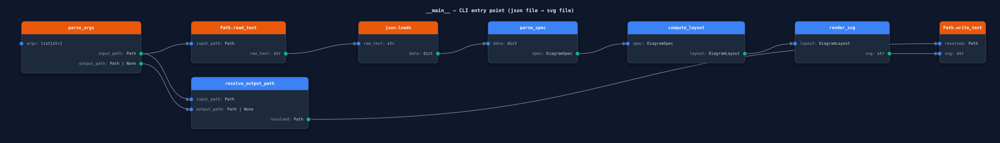

# dataflow-diagram

Generate SVG dataflow diagrams from a JSON spec.

Each function becomes a card. Input parameters appear on the left with blue dots, outputs on the right with green dots. Curved edges connect them. Before writing a single line of code, you have a visual map of what every function needs and what it returns.

**Zero dependencies.** Pure Python stdlib. Requires Python 3.11+.

---

## Example

The diagram below was generated by the tool documenting its own CLI pipeline (`examples/cli_main.json`):



---

## Installation

```bash
git clone https://github.com/YOUR_USERNAME/dataflow-diagram
cd dataflow-diagram
pip install uv        # if not already installed
uv sync
```

---

## Quick Start

```bash
# Generate a diagram
uv run python -m dataflow_diagram examples/cli_main.json

# Output written to: examples/cli_main.svg
# Open it in any browser or embed it in Markdown
```

Specify a custom output path with `-o`:

```bash
uv run python -m dataflow_diagram my_feature.json -o docs/my_feature.svg
```

---

## JSON Spec Format

A spec file has three top-level keys:

```json
{
  "title": "My Feature — data flow",
  "nodes": [ ... ],
  "edges": [ ... ]
}
```

### Node fields

| Field | Type | Required | Description |
|---|---|---|---|
| `id` | string | ✅ | Unique identifier used in edge references |
| `name` | string | ✅ | Display name shown in the card title |
| `column` | integer | ✅ | Horizontal column position (0 = leftmost). Nodes in the same column are stacked vertically. |
| `node_type` | string | — | `"function"` (default), `"datamodel"`, `"config"`, or `"library"` |
| `async` | boolean | — | Adds `async` prefix to the card title. Default: `false` |
| `inputs` | array | — | List of input ports (left side of card) |
| `outputs` | array | — | List of output ports (right side of card) |
| `exceptions` | array | — | List of exception ports (right side of card, red dots) |

### Node types

| Type | Title color | When to use |
|---|---|---|
| `function` | Blue `#3b82f6` | A function or method you write |
| `datamodel` | Violet `#7c3aed` | A dataclass, Pydantic model, or schema |
| `config` | Teal `#0d9488` | A configuration block or constants group |
| `library` | Orange `#ea580c` | A function from an external library (stdlib, third-party) |

### Port fields (`inputs` and `outputs`)

| Field | Type | Required | Description |
|---|---|---|---|
| `name` | string | ✅ | Port label shown on the card |
| `type` | string | ✅ | Type annotation shown next to the name. Use `""` for untyped ports. |
| `default` | string | — | Default value shown below the port name (truncated at 20 chars) |
| `internal` | boolean | — | Marks a port as an internal dependency (amber dot instead of blue). Use for values passed between sub-functions rather than received from the caller. Default: `false` |

### Exception ports

Exceptions use a simplified format — only a `name` field:

```json
"exceptions": [
  { "name": "ValueError" },
  { "name": "KeyError" }
]
```

Exception ports appear on the right side of the card with red dots and a `raises` prefix.

### Edges

Each edge connects one output port to one input port:

```json
{
  "from_node": "node_id",
  "from_port": "port_name",
  "to_node":   "other_node_id",
  "to_port":   "port_name"
}
```

Edges are drawn as curved bezier paths. They render under the cards, so cards always appear on top.

If an edge references a port that does not exist, it is skipped with a warning printed to stderr and a comment left in the SVG.

---

## Full Example

A two-node diagram showing an LLM service calling a router:

```json
{
  "title": "LLM Manager — get_response flow",
  "nodes": [
    {
      "id": "llm_service",
      "name": "LLMService.get_response",
      "node_type": "function",
      "column": 0,
      "inputs": [
        { "name": "llm_request", "type": "LLMRequest" }
      ],
      "outputs": [
        { "name": "response", "type": "LLMResponse" }
      ]
    },
    {
      "id": "router",
      "name": "LiteLLMRouter.completion",
      "node_type": "library",
      "column": 1,
      "inputs": [
        { "name": "model",       "type": "str" },
        { "name": "messages",    "type": "list[dict]" },
        { "name": "temperature", "type": "float",      "default": "0.7" },
        { "name": "max_tokens",  "type": "int | None", "default": "None" }
      ],
      "outputs": [
        { "name": "completion", "type": "ModelResponse" }
      ]
    }
  ],
  "edges": [
    {
      "from_node": "llm_service",
      "from_port": "response",
      "to_node":   "router",
      "to_port":   "messages"
    }
  ]
}
```

---

## Visual Reference

| Element | Color | Meaning |
|---|---|---|
| Input port dot | Blue `#3b82f6` | Parameter received from the caller |
| Output port dot | Green `#10b981` | Value returned or passed to the next function |
| Internal port dot | Amber `#C19552` | Value passed between internal sub-functions (not a caller parameter) |
| Exception port dot | Red `#dc2626` | Exception this function may raise |
| Function title bar | Blue `#3b82f6` | User-written function or method |
| Datamodel title bar | Violet `#7c3aed` | Data structure (dataclass, Pydantic model) |
| Config title bar | Teal `#0d9488` | Configuration or constants group |
| Library title bar | Orange `#ea580c` | External library call |
| Edge line | Slate `#64748b` | Data flowing from output port to input port |

---

## Makefile

```bash
# Generate one diagram
make run IN=examples/my_feature.json

# Regenerate all examples/*.json → .svg
make all
```

---

## Project Structure

```
dataflow_diagram/
├── __main__.py     # CLI: argparse → parse_spec → compute_layout → render_svg → write SVG
├── models.py       # Dataclasses: Port, NodeSpec, EdgeSpec, DiagramSpec, *Layout variants
├── layout.py       # compute_layout(spec) → DiagramLayout with x/y coordinates
└── renderer.py     # render_svg(layout) → SVG string (presentation attributes only)

examples/           # JSON specs + rendered SVGs (self-documenting the tool's own pipeline)
```

The tool uses **presentation attributes** only (no `<style>` block) so diagrams render correctly in GitHub Markdown and most SVG viewers.

---

## License

MIT
